# Zettelbranch user manual

Zettelbranch lets you branch a claude.ai conversation from any message into a new chat, and keeps your branches in order with short addresses, like the cards of a Zettelkasten:

```
sky/1    · Why the sky is blue
sky/1a   · Why sunsets are red          (a branch of sky/1)
sky/1a1  · The green flash              (a branch of sky/1a)
sky/1b   · The sky on Mars              (another branch of sky/1)
```

Each branch is an ordinary claude.ai chat. Its address is in its title, so you see your tree in the sidebar, on your phone, everywhere. Zettelbranch only adds a small panel to claude.ai in your browser.

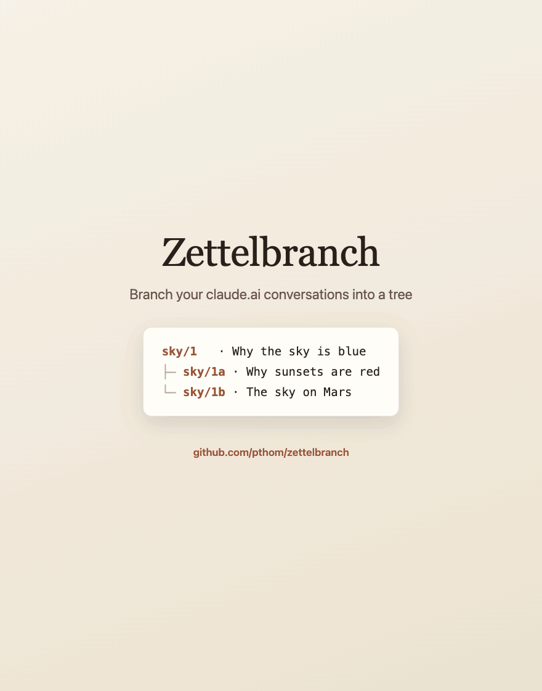

## Install

See the [README](../README.md#install). Then open claude.ai: a **Zettelbranch** button sits at the bottom right of the page.

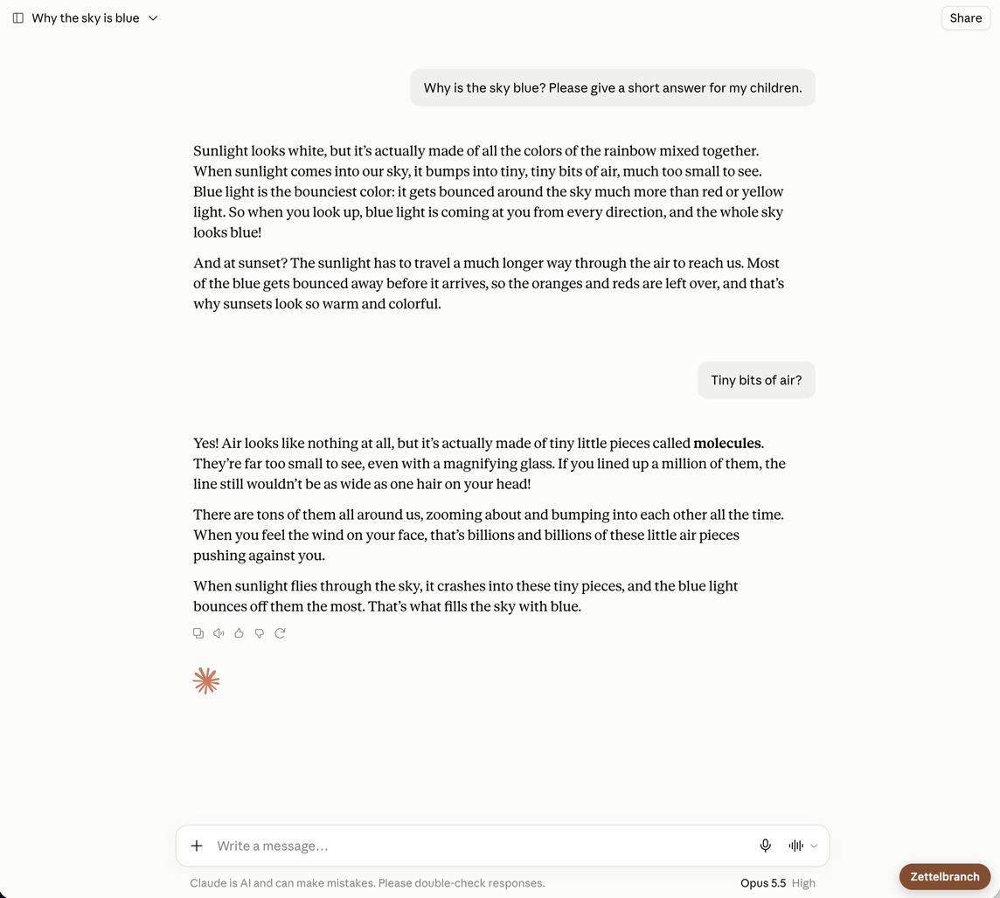

## Your first branch

### 1. Choose where the branch starts

Open any conversation and click the **Zettelbranch** button. The panel lists the conversation's messages, with Claude's last reply selected. Click another message to branch from there.

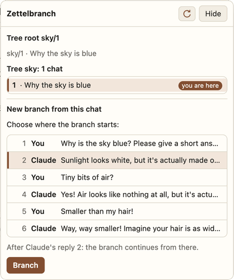

- **One of Claude's replies:** the new chat continues after it. You will ask something new.
- **One of your own messages:** the new chat is an alternative to it. Your message is put back in the box, for you to change.

### 2. Name the tree

The first time you branch a conversation, Zettelbranch asks for a short name for its tree, for example `sky`. The conversation is renamed `sky/1 · Why the sky is blue`: it becomes the tree's first card. Its topic stays claude.ai's title.

Tree names use lowercase letters, digits and `-`.

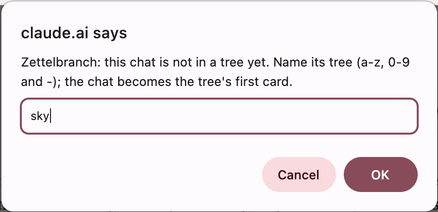

### 3. Read the preview

Zettelbranch shows the exact text it will put in the new chat, and its size.

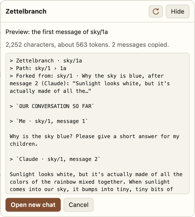

The text has three parts:

- **A short header:** the branch's address (`sky/1a`), its path from the root, and where it was forked from. It stays readable in the claude.ai apps, without the extension.
- **The conversation so far,** copied from the root to the message you chose, so Claude knows the context.
- **Instructions for Claude:** treat the copy as your shared history, start with a short summary of where the parent stood, and suggest a name for the branch.

Click **Open new chat**, or **Cancel**.

### 4. Ask your question

A new chat opens with the text in the message box. Type your question at the end of the box, after the instructions, then press **Send** yourself. Zettelbranch never sends anything.

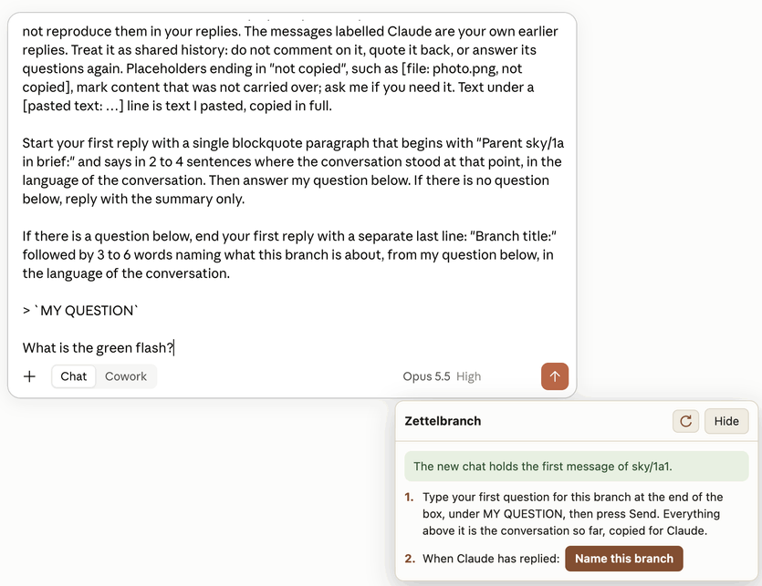

### 5. Claude's first reply

Claude starts with a short summary of the parent ("Parent sky/1 in brief: …"), then answers your question, and ends with a suggested name: "Branch title: Why sunsets are red".

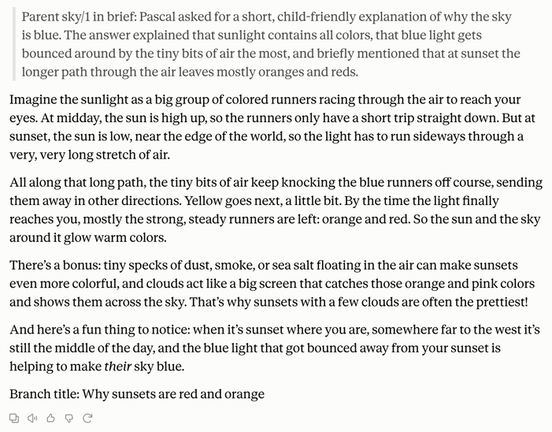

### 6. Name the branch

Click **Name this branch** in the panel. A small dialog proposes `sky/1a · Why sunsets are red`. Change the topic if you like; the address stays.

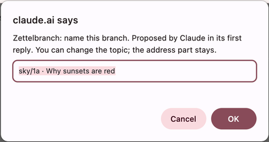

Click OK: the chat is renamed, and its new name shows at once at the top of the chat and in the sidebar. The panel now says what this chat is, and shows its tree.

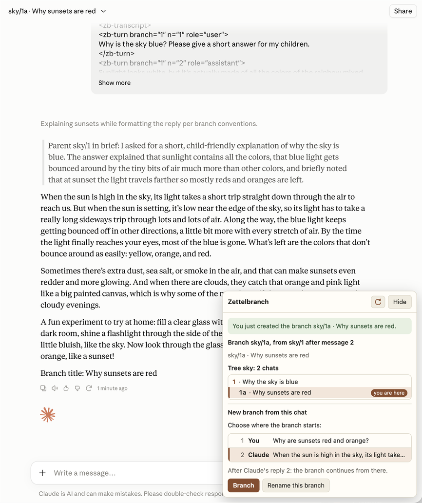

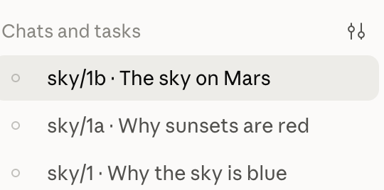

If claude.ai's own rename menu cannot be used, Zettelbranch renames the chat another way, and the panel tells you to reload the page to see the new name.

## The tree

### Addresses

An address alternates numbers and letters: `1`, then its branches `1a`, `1b`, `1c`…, then their branches `1a1`, `1a2`…, then `1a1a`… An address never changes: deleting a branch leaves a gap, and its neighbours keep their names.

Several trees can live side by side: `sky/1`, `trip/1`, `rust/1`. A second root in the same tree is `sky/2`.

### The tree in the panel

When the panel opens on a chat of a tree, it lists every chat of that tree, ordered and indented by address. The chat you are in is marked **you are here**; every other line is a link to that chat.

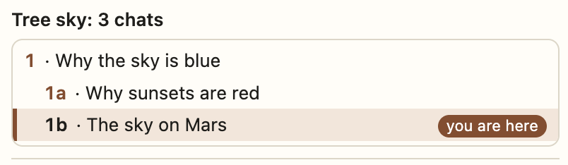

At the top, the panel says what the current chat is: "Branch sky/1a, from sky/1 after message 2", or "Tree root sky/1".

While the panel is open, it follows you: move to another chat with the sidebar and the panel shows that chat. Hide the panel and it stops. The round arrow at the top reads the chat and its tree again.

## More

### Branch of a branch

Branch from a branch exactly as from a root. The new chat gets the whole story from the root, as one flat conversation: `sky/1`'s messages, then `sky/1a`'s, up to the point you chose.

### Rename a branch later

In a branch that already has a name, **Rename this branch** lets you change its topic.

### Titles typed by hand

You can also give a chat a tree title yourself, in claude.ai. The separator is ` · `, but ` . ` and ` - ` work too, since `·` is awkward to type: `sky/2 . Rainbows`.

### What is copied into a branch

- Text, code, tables and formulas, as written.
- Text you pasted, in full.
- Not copied: images, other files and artifacts. They become placeholders such as `[file: photo.png, not copied]`; Claude can ask you for them.
- Left out: Claude's thinking and tool calls.

A very long conversation makes a long first message. Above 100,000 characters, the preview warns you.

### Why a copy, and not claude.ai's own branches?

claude.ai can branch a conversation when you edit or retry a message, but those branches stay inside one conversation, behind small `< 1/2 >` arrows: they have no name of their own, do not show in the sidebar, and cannot be linked. A Zettelbranch branch is a separate chat, with its own address and title, visible everywhere.

## Privacy and trust

- Zettelbranch has no permissions and talks only to claude.ai, in one file, `extension/api.js`.
- It reads your conversations only when you open its panel or click, and renames a chat or fills the message box only when you click. It never sends a message and never deletes anything.
- It never reads your login, and it stores nothing: no history, no copy of your conversations.

[AUDIT.md](../AUDIT.md) lists what the code never does, with the commands that prove it.

## When something goes wrong

- **"claude.ai changed, Zettelbranch needs an update":** claude.ai's internal API answered something unexpected. Branching from the messages on screen may still work; the panel says so.
- **The message box already holds text:** Zettelbranch does not overwrite a draft. Empty the box, then click Open new chat again.
- **The new name does not show:** reload the page. Your other devices show it already.
- **Firefox:** a temporary add-on is removed when Firefox quits; load it again from `about:debugging`.
